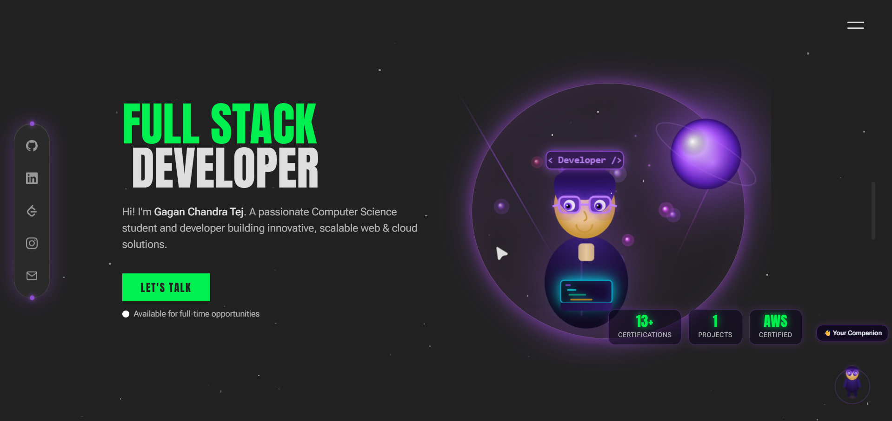

<div align="center">

# 🚀 Vengala Gagan Chandra Tej — Full Stack Developer Portfolio

### Full Stack Developer · AI/ML Enthusiast · Cloud Builder

[](https://vengala-gagan.vercel.app/)
[](LICENSE)
[](https://nextjs.org/)
[](https://tailwindcss.com/)
[](https://aws.amazon.com/)

**[Live Site](https://vengala-gagan.vercel.app/) · [Report Bug](https://github.com/Gagan3287/My-Portfolio/issues) · [Request Feature](https://github.com/Gagan3287/My-Portfolio/issues)**

</div>

---

## 👤 About

This is the source code of the portfolio website of **Vengala Gagan Chandra Tej** (also known as Gagan Vengala, GitHub username Gagan3287), a Full Stack Developer and AI/ML student from Warangal, Telangana, India. He is a B.Tech Computer Science (AI & ML) student at SR University, Warangal, graduating in 2028.

- **Live website:** [vengala-gagan.vercel.app](https://vengala-gagan.vercel.app/)
- **Team lead of AyuLink**, a low-cost offline patient monitoring system that won 1st Prize in the Health domain at Pragathi 2.0, SR University (October 2026)
- **Built VanSetu**, a WebGIS decision support system, for Smart India Hackathon 2026 (selected in the college internal round)
- Builds full-stack apps and AI systems with React, Next.js, Node.js, FastAPI, Python and PostgreSQL

## 📖 Overview

This isn't just a resume in website form — it's where I document what I'm actually building. From RAG-powered writing assistants to rule-based conversational engines, this portfolio is a running log of projects at the intersection of full-stack engineering, cloud infrastructure, and applied AI/ML.

> *"Building technology that is not only functional but meaningful — solutions that bridge complex ideas and real-world impact."*

## 🌐 Pages on the website

| Page | What it has |
|---|---|
| [Home](https://vengala-gagan.vercel.app/) | Introduction, skills, education, certifications and project showcase |
| [About](https://vengala-gagan.vercel.app/about) | Full profile, achievements, FAQ and links to all profiles |
| [Projects](https://vengala-gagan.vercel.app/#projects) | A detail page for each project at `/projects/<name>` |
| [Blog](https://vengala-gagan.vercel.app/blog) | Write-ups, including how AyuLink won 1st Prize at Pragathi 2.0 |
| [SR University](https://vengala-gagan.vercel.app/sr-university) | Student developer portfolios from SR University, Warangal |

## ✨ Key Features

| | |
|---|---|
| ⚡ **Modern Stack** | Built on Next.js for speed, SEO, and a snappy dev experience |
| 🎨 **Polished, Personal UI** | Custom design with a 3D avatar and smooth section transitions |
| 📄 **Live Resume Download** | Always current — no stale PDF links |
| 🏆 **26-Certification Showcase** | AWS, Azure, IBM, and Cisco credentials, viewable inline |
| 💼 **Real, Deployed Projects** | Live demos, not screenshots — Quill AI and RuleBot both run in production |
| 📝 **Blog and Project Pages** | Each project has its own page, plus a blog for write-ups |
| 🔎 **SEO-ready** | Sitemap, robots file, canonical URLs and structured data (Person, WebSite, FAQ) |
| 📱 **Fully Responsive** | Tested across mobile, tablet, and desktop breakpoints |
| 📬 **Direct Contact** | One click to email, no contact-form friction |

## 🛠 Tech Stack

**Languages**
`Python` · `JavaScript` · `TypeScript` · `C` · `C++` · `Kotlin`

**Frontend**
`React` · `Next.js` · `Tailwind CSS` · `Bootstrap`

**Backend**
`Node.js` · `Django` · `Flask` · `FastAPI`

**AI / ML**
`TensorFlow` · `PyTorch` · `Scikit-learn` · `OpenCV` · `NumPy` · `Pandas` · `Hugging Face`

**Databases**
`SQL` · `MySQL` · `PostgreSQL` · `MongoDB` · `Firebase` · `Redis`

**Cloud & DevOps**
`AWS` · `Azure` · `Docker` · `Vercel` · `Git` · `GitHub` · `Linux`

**Tooling**
`VS Code` · `Jupyter` · `Figma` · `Postman` · `Photoshop`

## 🧩 Featured Projects

### [Quill AI](https://quill-ai-eight.vercel.app/) — *Intelligent Writing & Research Companion*
A next-generation AI-powered platform for writing, research, and knowledge synthesis. Brainstorms ideas, summarizes documents, answers complex questions, and refines prose in one interface.
`Next.js` `OpenAI` `Vercel` `TypeScript` `Tailwind CSS`

### [RuleBot](https://codsoft-task-01-phi.vercel.app/) — *Rule-Based AI Chatbot*
A full-stack chatbot delivering deterministic, context-aware responses — no generative AI required. Next.js frontend, FastAPI backend, Dockerized, deployed across Vercel and Render.
`Next.js` `React` `FastAPI` `Python` `Docker` `REST API`

### More projects

| Project | What it is | Links |
|---|---|---|
| **AyuLink** | Low-cost offline patient monitoring system; 1st Prize, Health domain, Pragathi 2.0, SR University | [Details](https://vengala-gagan.vercel.app/projects/ayulink) |
| **VanSetu** | AI-powered FRA Atlas and WebGIS decision support system for Smart India Hackathon 2026 | [Details](https://vengala-gagan.vercel.app/projects/vansetu) |
| **FedLearn Hub** | Federated learning in the browser with TensorFlow.js and FastAPI | [Details](https://vengala-gagan.vercel.app/projects/fedlearn-hub) · [Live](https://fed-learn.vercel.app) |
| **StudyMate AI** | AI study and placement companion for engineering students | [Details](https://vengala-gagan.vercel.app/projects/studymate-ai) · [Live](https://studymate-aix.vercel.app/) · [Source](https://github.com/Gagan3287/Student-Ai) |
| **HomelyHub** | AI-powered stay-booking platform built with the MERN stack | [Details](https://vengala-gagan.vercel.app/projects/homelyhub) · [Live](https://homely-hubx.vercel.app) · [Source](https://github.com/Gagan3287/HomelyHubInternshipBatch8) |
| **SRU Lost & Found** | Lost-and-found platform for SR University students | [Details](https://vengala-gagan.vercel.app/projects/sru-lost-found) · [Live](https://sru-lost-found.vercel.app) |

## 🚀 Getting Started

**Prerequisites:** Node.js v18+ and `pnpm`

```bash
# Clone the repository
git clone https://github.com/Gagan3287/My-Portfolio.git

# Move into the project
cd My-Portfolio

# Install dependencies
pnpm install

# Run the dev server
pnpm dev
```

Then open [http://localhost:3000](http://localhost:3000) in your browser.

**Build for production:**

```bash
pnpm build
```

## 📂 Project Structure

```
├── app/                 # Next.js app router pages (home, about, blog, projects, sr-university)
├── components/          # Reusable UI components
│   └── ui/               # Base design-system components
├── lib/                 # Site config, project data and blog posts
├── public/               # Static assets, resume PDF, certifications, blog images
└── types/                # TypeScript types
```

## 🗺️ Roadmap

- [x] Blog section for AI/ML write-ups and project deep-dives
- [ ] Live project analytics dashboard
- [ ] Command-palette style navigation (⌘K)
- [ ] Add third flagship project as it ships

## 🤝 Contributing

Contributions, issues, and feature requests are welcome.

1. Fork the repository
2. Create your feature branch (`git checkout -b feature/amazing-feature`)
3. Commit your changes (`git commit -m 'Add amazing feature'`)
4. Push to the branch (`git push origin feature/amazing-feature`)
5. Open a Pull Request

## ⭐ Support

If this project helped or inspired you, consider giving it a star on GitHub — it genuinely helps visibility.

**Repository:** [github.com/Gagan3287/My-Portfolio](https://github.com/Gagan3287/My-Portfolio)

## 📬 Connect With Me

- **Portfolio:** [vengala-gagan.vercel.app](https://vengala-gagan.vercel.app/)
- **GitHub:** [@Gagan3287](https://github.com/Gagan3287)
- **LinkedIn:** [vengala-gagan-176a9433a](https://www.linkedin.com/in/vengala-gagan-176a9433a)
- **LeetCode:** [Vengala_Gagan](https://leetcode.com/u/Vengala_Gagan/)
- **Kaggle:** [vengalagagan](https://www.kaggle.com/vengalagagan)
- **Google Scholar:** [Vengala Gagan Chandra Tej](https://scholar.google.com/citations?user=zWMaXuMAAAAJ&hl=en)
- **ResearchGate:** [Gagan Vengala](https://www.researchgate.net/profile/Gagan-Vengala)
- **GeeksforGeeks:** [2403a5tyu3](https://www.geeksforgeeks.org/profile/2403a5tyu3)
- **Instagram:** [@gagan_vengala](https://www.instagram.com/gagan_vengala/)
- **Email:** [tejchandra100@gmail.com](mailto:tejchandra100@gmail.com)

## 📄 License

This project is licensed under the MIT License — see the [LICENSE](https://github.com/Gagan3287/My-Portfolio/blob/main/LICENSE) file for details.

---

<div align="center">

☕ 🖤Built with focus, curiosity, and way too much coffee — **Vengala Gagan Chandra Tej**🖤 ☕

</div>